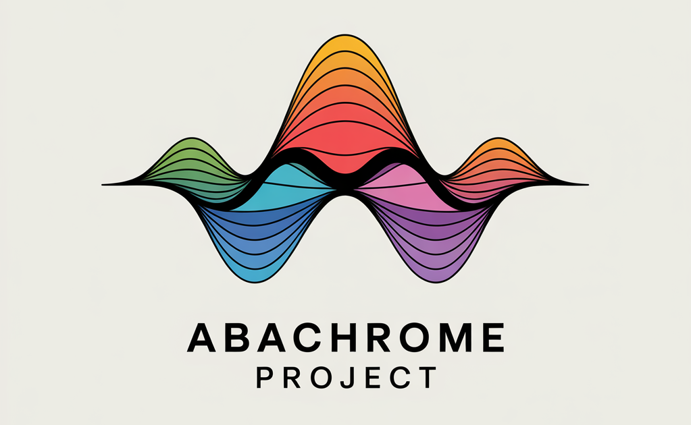

# Abachrome

[](https://opensource.org/licenses/MIT)
[](https://www.ruby-lang.org/en/)
[](https://badge.fury.io/rb/abachrome)
[](https://rubygems.org/gems/abachrome)
[](https://github.com/durableprogramming/abachrome)
[](http://makeapullrequest.com)
[](https://github.com/rubocop/rubocop)
[](https://github.com/tophat/getting-started/blob/master/scorecard.md)
[](https://durableprogramming.com)

Abachrome is a Ruby gem for parsing, manipulating, and managing colors. It provides a robust set of tools for working with various color formats including hex, RGB, HSL, and named colors.



## Getting Help

Questions about Abachrome? [Practical Ruby Gems](https://practicalrubygems.com/gems/abachrome/) is a good place to get them answered.

## Installation

Add this line to your application's Gemfile:

```ruby
gem 'abachrome'
```

And then execute:

```bash
$ bundle install
```

Or install it yourself as:

```bash
$ gem install abachrome
```

## Quick Start

```ruby
color = Abachrome.from_hex('#FF0000')
other = Abachrome::Parsers::CSS.parse('oklch(0.5 0.2 120)')

oklab = color.to_oklab
lighter = color.lighten(0.2)
blended = color.blend(other, 0.5)
Abachrome::Outputs::CSS.format_rgb(color)   # => "rgb(255, 0, 0)"
```

See [docs/usage.md](docs/usage.md) for parsing, conversion, output formats, manipulation, palettes, and gamut mapping.

## Features

- Support for multiple color spaces (RGB, HSL, Lab, Oklab, OKLCH, XYZ, LMS)
- Color space conversion between all supported spaces
- Advanced gamut mapping for sRGB, P3, and Rec.2020
- Comprehensive CSS color parsing and formatting
- Support for CSS named colors
- Color blending and lightness adjustments
- Palette creation and interpolation
- High-precision color calculations using BigDecimal
- Alpha channel support throughout all operations

## Requirements

- Ruby >= 3.0.0

## Documentation

- [Usage](docs/usage.md)
- [Dependencies](docs/dependencies.md)
- [Development and testing](docs/development.md)
- [Contributing](docs/contributing.md), including how to report defects
- [Governance](docs/governance.md)
- [Security policy](SECURITY.md)
- [Changelog](CHANGELOG.md)

## Security

Please report security issues privately. See [SECURITY.md](SECURITY.md) rather than opening a public issue.

## License

The gem is available as open source under the terms of the [MIT License](https://opensource.org/licenses/MIT).

## Acknowledgement

We'd like to thank the excellent Color.js and culori color libraries, which helped inspire this project and
inform its design.

## Commercial Support

Commercial support for this tool is available from Durable Programming, LLC. You can find out more at [durableprogramming.com](https://durableprogramming.com/) or via email at [commercial@durableprogramming.com](mailto:commercial@durableprogramming.com).

## Copyright

Copyright 2025, Durable Programming LLC. All rights reserved.
